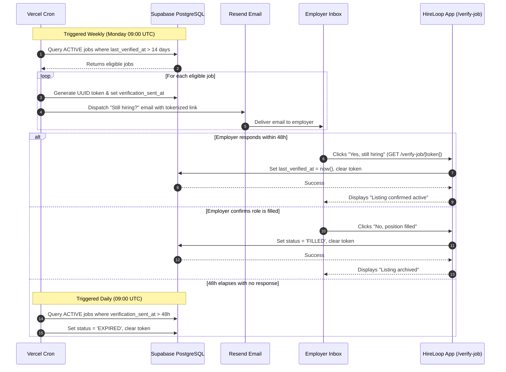

# ✅ Fully Fixed README

Here's the complete corrected file. Copy-paste ready — all facts verified against your actual project.

```markdown
# HireLoop 🔄

> **The zero-stale job marketplace.** Automated 14-day verification loops that keep postings genuinely active.

[](https://nextjs.org/)
[](https://www.typescriptlang.org/)
[](https://supabase.com/)
[](https://aws.amazon.com/s3/)
[](https://vercel.com/)

[Live Demo](https://realjobs-khaki.vercel.app) · [Report a Bug](https://github.com/Vivan2025wd/real_jobs/issues) · [Request a Feature](https://github.com/Vivan2025wd/real_jobs/issues)

---

## Why HireLoop is Different

Job boards suffer from one systemic flaw: **stale, ghost listings**. Employers fill roles and abandon their posts, leaving job seekers shouting into the void and recruiters inundated with irrelevant resumes.

HireLoop eliminates this through an **automated verification loop**:
1. Every 14 days, employers receive an automated email asking: *"Still hiring for this role?"*
2. With a single click (no password or login required), the employer confirms the post is open or marks it filled.
3. If they don't respond within **48 hours**, the listing is automatically expired and removed from public search.

The result is a board where every single listing is guaranteed to have been confirmed by an actual human within the last fortnight.

---

## Table of Contents

- [Screenshots](#screenshots)
- [Core Features](#core-features)
- [The Verification Loop](#the-verification-loop)
- [Tech Stack](#tech-stack)
- [Architecture](#architecture)
- [Database Schema & RLS](#database-schema--rls)
- [Getting Started](#getting-started)
  - [Prerequisites](#prerequisites)
  - [Local Development](#local-development)
  - [Environment Variables](#environment-variables)
  - [AWS S3 Setup](#aws-s3-setup)
- [Deployment](#deployment)
  - [Vercel Deployment](#vercel-deployment)
  - [Post-Deploy Checklist](#post-deploy-checklist)
- [Project Structure](#project-structure)
- [Design Decisions](#design-decisions)
- [Engineering Audit & Resolution](#engineering-audit--resolution)
- [Roadmap](#roadmap)
- [License](#license)

---

## Screenshots

> The app is live at **[realjobs-khaki.vercel.app](https://realjobs-khaki.vercel.app)** — visit it to see the current UI. Static screenshots are added below as the portfolio grows.

| Public Job Board | Job Detail & JSON-LD |
| :---: | :---: |
| *Fast, filtered search with work type, salary, & categories* | *Clean listing with Google Jobs schema & direct application* |

| Employer Dashboard | Single-Click Verification |
| :---: | :---: |
| *Manage listings, payment status, and applications* | *Tokenized single-click verification without logging in* |

---

## Core Features

### For Employers
- **Company Profile Management**: Configure company identity, logo, and verified badge.
- **Structured Job Authoring**: Role descriptions, compensation ranges in LKR, work type (Remote, Hybrid, Onsite), and standardized categories.
- **Integrated Payments**: Frictionless LKR 2,500 listing fee powered by PayHere popup checkout.
- **Applicant Tracking**: Review incoming seeker applications per listing with applied dates, statuses, and direct resume downloads.
- **Zero-Friction Re-verification**: One-click confirmation links sent directly to inbox on a 14-day schedule.

### For Job Seekers
- **Curated, Fresh Postings**: Guaranteed active listings verified within 14 days; no dead or ghost jobs.
- **One-Click Application**: Upload resume once; apply instantly to open positions without re-uploading.
- **Privacy & Performance**: Resumes are uploaded directly from the browser to an encrypted private AWS S3 bucket.
- **Application Dashboard**: Track status (Pending, Reviewed, Shortlisted, Rejected) in real time.

### Platform & Automation
- **Vercel Cron Orchestration**: Weekly dispatching of verification emails and daily expiration sweeps.
- **Incremental Static Regeneration (ISR)**: Public job detail pages cached globally and revalidated every 5 minutes.
- **Role-Based Routing**: Strict middleware-enforced role isolation preventing seekers and employers from accessing each other's spaces.

---

## The Verification Loop

The heart of HireLoop is an automated state machine triggered by background crons:



---

## Tech Stack

| Layer | Technology | Rationale |
| :--- | :--- | :--- |
| **Framework** | Next.js 14 (App Router) | Server Components for instant initial paint, Server Actions for mutations, and Edge Middleware for auth routing. |
| **Language** | TypeScript 5.6 (Strict) | End-to-end type safety across database schemas, API contracts, and form inputs. |
| **Database** | Supabase (PostgreSQL 15) | Relational integrity with strict constraints, cascading foreign keys, and Row-Level Security (RLS). |
| **Auth** | Supabase Auth | Cookie-based session handling with PKCE exchange, magic link OTP, and custom metadata roles. |
| **Object Storage** | AWS S3 | Encrypted, highly scalable storage. Private bucket for resumes; public bucket for logos. |
| **Payments** | PayHere Payment Gateway | Localized Sri Lankan payment gateway supporting LKR 2,500 fees via server-hashed checkout and HMAC signature verification. |
| **Email** | Resend | Modern transactional email delivery with high inbox deliverability. |
| **Styling** | Tailwind CSS | Utility-first CSS compiling to minimal production bundles without runtime overhead. |
| **Hosting & Crons**| Vercel | Global edge network with integrated Vercel Cron jobs for serverless scheduled tasks. |

---

## Architecture

```
                          ┌──────────────────────────────────────────────┐
                          │                Client Browser                │
                          └───────┬──────────────────────────────▲───────┘
                                  │                              │
                    HTTPS Requests│                              │Direct S3 PUT
                                  ▼                              │(Presigned URL)
                          ┌───────────────────────────────┐      │
                          │     Next.js 14 Edge/Node      │      │
                          │   (Vercel App Router / ISR)   │      │
                          └───────┬───────────────┬───────┘      │
                                  │               │              │
                   Cookies / RLS  │               │              │
                                  ▼               │Service Role  │
                          ┌───────────────┐       │(Cron/Webhook)│
                          │ Supabase Auth │       ▼              │
                          │ & PostgreSQL  │ ┌───────────┐        │
                          └───────────────┘ │ Admin DB  │        │
                                            └───────────┘        │
                                                  │              │
                   PayHere Webhook                ▼              │
             ┌─────────────────────────┐    ┌───────────┐        │
             │   PayHere Gateway API   │    │  Resend   │        │
             └─────────────────────────┘    │ Transaction│       │
                                            └─────┬─────┘        │
                                                  │              │
                                                  ▼              ▼
                                            ┌───────────┐ ┌──────────────┐
                                            │ Employer  │ │ AWS S3 Bucket│
                                            │   Inbox   │ │  (Resumes)   │
                                            └───────────┘ └──────────────┘
```

### Key Architectural Tenets
1. **The Three-Client Supabase Pattern**:
   - `client.ts`: Browser-only client using `createBrowserClient` with public anon key and RLS.
   - `server.ts`: Server Component and Server Action client using cookie storage with RLS.
   - `admin.ts`: Service-role client guarded with `server-only` strictly reserved for webhooks and cron tasks.
2. **Zero-Byte File Relay**: User resumes never touch or buffer through the Next.js server. The client requests a 5-minute pre-signed PUT URL and uploads directly to AWS S3.
3. **Cookie-Free ISR for Public Pages**: `/jobs/[jobId]` statically pre-renders with `revalidate = 300` using a cookie-free anonymous Supabase client so public visitors enjoy instant response times.

---

## Database Schema & RLS

HireLoop uses 5 relational tables in PostgreSQL:

- `public.users`: Mirrors `auth.users` with `role` (`EMPLOYER` or `JOB_SEEKER`) and `resume_url`.
- `public.companies`: Employer company profiles (`employer_id` references `users.id`).
- `public.jobs`: Job listings with work type, salary ranges, verification status, and tokens.
- `public.applications`: Job applications linking `job_id` and `seeker_id` with a unique constraint preventing duplicate submissions.
- `public.payments`: Payment audit ledger tracking PayHere `order_id`, amount, and gateway references.

### Row-Level Security (RLS) Policy Highlights
- **Companies**: Readable by everyone; write/update restricted to the company owner (`auth.uid() = employer_id`).
- **Jobs**: Active jobs are readable by the public; drafts and archived jobs are only visible to the owner company.
- **Applications**: Seekers can only insert and read their own applications (`auth.uid() = seeker_id`). Employers can only read applications submitted to jobs owned by their company.
- **Payments**: Users can only inspect their own payments (`auth.uid() = user_id`). Webhooks use the service role.

---

## Getting Started

### Prerequisites
- Node.js 18.18+ or 20.x
- AWS Account with an S3 Bucket and IAM user credentials
- Supabase Project (cloud or local Supabase CLI)
- PayHere Merchant Account (or Sandbox credentials)
- Resend Account & verified sending domain

### Local Development

1. **Clone the repository**:
   ```bash
   git clone https://github.com/Vivan2025wd/real_jobs.git
   cd real_jobs
   ```

2. **Install dependencies**:
   ```bash
   npm install
   ```

3. **Configure environment variables**:
   ```bash
   cp .env.local.example .env.local
   # Fill in your Supabase, AWS, PayHere, and Resend credentials
   ```

4. **Initialize Supabase**:
   ```bash
   # Link to your Supabase project
   npx supabase link --project-ref <your-project-ref>

   # Push schema migrations to Supabase
   npx supabase db push

   # Generate TypeScript types from the live schema
   npx supabase gen types typescript --project-id <your-project-ref> \
     | Out-File src/types/database.types.ts -Encoding utf8
   ```

5. **Run the development server**:
   ```bash
   npm run dev
   ```
   Open [http://localhost:3000](http://localhost:3000) in your browser.

---

## Environment Variables

All environment variables used by HireLoop, documented with their requirements:

```bash
# ==============================================================================
# Supabase Configuration
# ==============================================================================
NEXT_PUBLIC_SUPABASE_URL=https://your-project.supabase.co
NEXT_PUBLIC_SUPABASE_ANON_KEY=eyJhbGciOiJIUzI1NiIsInR5cCI6...
# Service role key must NEVER be prefixed with NEXT_PUBLIC_
SUPABASE_SERVICE_ROLE_KEY=eyJhbGciOiJIUzI1NiIsInR5cCI6...

# ==============================================================================
# Application URL
# ==============================================================================
# Local: http://localhost:3000
# Production: https://your-app.vercel.app  (MUST include https://)
NEXT_PUBLIC_APP_URL=http://localhost:3000

# ==============================================================================
# AWS S3 Storage (Private Resumes & Public Logos)
# ==============================================================================
# AWS_REGION must match the region where your buckets live exactly.
# Find it: AWS Console → S3 → your bucket → Region column.
# Common values:
#   ap-southeast-2  = Asia Pacific (Sydney)
#   ap-south-1      = Asia Pacific (Mumbai)
#   us-east-1       = US East (N. Virginia)
AWS_REGION=ap-southeast-2

# Bucket names — use the FULL name from AWS Console (including any suffix).
S3_PRIVATE_BUCKET=your-resumes-bucket-name
S3_PUBLIC_BUCKET=your-assets-bucket-name

# Optional. Leave EMPTY to serve logos directly from S3.
# Only set this if you've configured a CloudFront distribution:
#   https://d111111abcdef8.cloudfront.net
# The app auto-detects placeholder values like "https://cdn.yourdomain.com"
# and silently falls back to direct S3 URLs — a common copy-paste hazard.
CLOUDFRONT_PUBLIC_DOMAIN=

AWS_ACCESS_KEY_ID=AKIA...
AWS_SECRET_ACCESS_KEY=...

# ==============================================================================
# PayHere Payment Gateway (Sri Lanka)
# ==============================================================================
PAYHERE_MERCHANT_ID=1210000
PAYHERE_MERCHANT_SECRET=your_payhere_merchant_secret
# Use 'sandbox' for staging or 'production' for live payments
PAYHERE_MODE=sandbox

# ==============================================================================
# Resend Email Delivery
# ==============================================================================
RESEND_API_KEY=re_...
# For testing, "onboarding@resend.dev" only sends to your own verified email.
# For production, verify a domain and use "notifications@yourdomain.com".
EMAIL_FROM=HireLoop <onboarding@resend.dev>

# ==============================================================================
# Vercel Cron Security Secret
# ==============================================================================
# Generate: openssl rand -base64 32
# Or PowerShell: [Convert]::ToBase64String((1..32 | ForEach-Object { Get-Random -Max 256 }))
# Must be set in Vercel env vars too, or crons return 401.
CRON_SECRET=
```

---

## AWS S3 Setup

### Resumes Bucket (private)

Create an S3 bucket for resumes with **Block Public Access enabled** (default). Configure CORS on the bucket to allow browser `PUT` uploads:

```json
[
  {
    "AllowedHeaders": ["*"],
    "AllowedMethods": ["PUT", "GET", "HEAD"],
    "AllowedOrigins": [
      "http://localhost:3000",
      "https://your-app.vercel.app"
    ],
    "ExposeHeaders": ["ETag"],
    "MaxAgeSeconds": 3000
  }
]
```

### Logos Bucket (public)

Create a **second** bucket for company logos. This bucket needs:

1. **Block Public Access disabled** (uncheck all four boxes).
2. **Bucket policy** allowing public `GetObject`:

   ```json
   {
     "Version": "2012-10-17",
     "Statement": [
       {
         "Sid": "PublicReadLogos",
         "Effect": "Allow",
         "Principal": "*",
         "Action": "s3:GetObject",
         "Resource": "arn:aws:s3:::your-assets-bucket-name/*"
       }
     ]
   }
   ```

3. **Same CORS configuration** as above (needed for browser PUTs).

### IAM Permissions

Your IAM user needs `s3:PutObject`, `s3:GetObject`, and `s3:DeleteObject` on both buckets:

```json
{
  "Version": "2012-10-17",
  "Statement": [
    {
      "Effect": "Allow",
      "Action": ["s3:PutObject", "s3:GetObject", "s3:DeleteObject"],
      "Resource": [
        "arn:aws:s3:::your-resumes-bucket-name/*",
        "arn:aws:s3:::your-assets-bucket-name/*"
      ]
    },
    {
      "Effect": "Allow",
      "Action": ["s3:ListBucket"],
      "Resource": [
        "arn:aws:s3:::your-resumes-bucket-name",
        "arn:aws:s3:::your-assets-bucket-name"
      ]
    }
  ]
}
```

---

## Deployment

### Vercel Deployment

1. Connect your repository to Vercel.
2. In Project Settings → Environment Variables, populate all variables listed in `.env.local.example`.
3. Vercel automatically detects `vercel.json` and configures the two cron schedules:
   - `/api/cron/verify-jobs`: Weekly (Mondays 09:00 UTC)
   - `/api/cron/expire-jobs`: Daily (09:00 UTC)

### Post-Deploy Checklist

- [ ] Ensure `CRON_SECRET` in Vercel environment matches the Authorization header Vercel Cron sends.
- [ ] Configure PayHere Merchant Portal return URL, cancel URL, and notify URL domain whitelisting.
- [ ] Verify your domain in Resend to ensure verification emails pass SPF/DKIM checks.
- [ ] Confirm S3 CORS allows your production Vercel domain on **both** buckets.
- [ ] Verify the assets bucket is publicly readable (paste a logo URL into a private browser window).
- [ ] Trigger both cron jobs manually from the Vercel dashboard → Cron Jobs tab → Run now, and confirm they return `{ ok: true }`.

---

## Project Structure

```
├── public/                 # Static public assets (logos, favicon)
├── scripts/
│   └── generate-db-types.ts# Supabase TypeScript schema generator
├── src/
│   ├── app/
│   │   ├── (auth)/         # Login, register, auth callback
│   │   ├── api/            # Route handlers (cron, payments, S3 presigned)
│   │   ├── dashboard/      # Protected employer and seeker dashboards
│   │   ├── jobs/           # Public job browse, search, and detail (ISR)
│   │   ├── verify-job/     # Tokenized single-click verification landing
│   │   ├── layout.tsx      # Root HTML layout with Inter font
│   │   └── page.tsx        # Landing hero and marketing page
│   ├── components/
│   │   ├── applications/   # Application cards and apply action button
│   │   ├── auth/           # Split-screen AuthShell for login/register
│   │   ├── employer/       # Job authoring form, verification toggle, logo uploader
│   │   ├── jobs/           # Job cards, search filters, detail view
│   │   ├── payment/        # Client PayHere checkout button SDK wrapper
│   │   ├── seeker/         # Resume direct uploader component
│   │   └── ui/             # Core design system primitives (Button, Card, Badge)
│   ├── hooks/              # Custom React hooks (useJobs, useUser)
│   ├── lib/
│   │   ├── cron/           # Job lifecycle automation logic
│   │   ├── email/          # Resend transactional email client
│   │   ├── payhere/        # Payment hash generation & md5sig verification
│   │   ├── s3/             # S3 client and pre-signed URL builder
│   │   ├── supabase/       # 3-client architecture (client, server, admin)
│   │   ├── utils/          # Formatting, constants
│   │   └── validators/     # Zod validation schemas
│   ├── types/              # Domain and database TypeScript definitions
│   └── middleware.ts       # Edge auth refresh and role-based routing
├── supabase/
│   ├── migrations/         # Idempotent PostgreSQL DDL migrations
│   ├── config.toml         # Local Supabase CLI configuration
│   └── seed.sql            # Local test data
├── vercel.json             # Vercel deployment configuration & cron schedule
├── package.json
└── tsconfig.json
```

---

## Design Decisions

### 1. The Verification Loop vs. Fixed Expiration Dates
Most job boards set arbitrary 30-day or 60-day listing expirations. This is ineffective: hot engineering roles often fill within 7 days, leaving a 3-week zombie post, while niche leadership roles may legitimately remain open for 90 days. HireLoop decouples expiration from total listing age by anchoring to a 14-day *recency of human confirmation*. If an employer is responsive, a role can remain live for months; if they fill the role or ghost their inbox, it disappears in 48 hours.

### 2. The Three-Client Supabase Architecture
Supabase authentication in Next.js App Router requires strict client boundary separation. We enforce three separate client initializers:
- `client.ts` uses `@supabase/ssr`'s `createBrowserClient` with public anon keys for interactive client components.
- `server.ts` uses `createServerClient` reading from `next/headers` cookies, automatically propagating refreshed JWT tokens while respecting RLS.
- `admin.ts` uses `@supabase/supabase-js` with the service-role key. We mark this module with `import "server-only"` to prevent bundlers from ever leaking it into client bundles, restricting its use exclusively to webhooks and automated cron routines.

### 3. Direct Browser-to-S3 Presigned Uploads
Allowing applicant PDF resumes to stream through Next.js serverless functions is an anti-pattern: it consumes expensive Vercel compute execution memory, risks hitting the 4.5 MB serverless payload ceiling, and exposes the app server to uninspected byte streams. Instead, the server inspects the MIME type and file size, authenticates the applicant, and signs an S3 `PutObjectCommand`. The browser uploads bytes directly to AWS over HTTPS, storing only the sanitized object key in PostgreSQL.

### 4. ISR with Cookie-Free Anonymous Clients for Public Jobs
Public job seekers demand sub-100ms response times and search engines require crawlable static HTML. Next.js App Router will silently de-opt static generation into dynamic rendering if `cookies()` is accessed during rendering. In `/jobs/[jobId]/page.tsx`, we deliberately instantiate a standalone cookie-free Supabase anonymous client with `revalidate = 300`. This enables full Incremental Static Regeneration (ISR) and Google Jobs JSON-LD schema generation without losing Edge caching benefits.

### 5. Server-Generated Payment Hashing & Webhook Signature Verification
Client-side payment parameters can be tampered with in transit. In our PayHere integration, the checkout hash (`MD5(merchant_id + order_id + amount + currency + uppercase(MD5(secret)))`) is calculated strictly on the server in `/api/payment/start`. Upon completion, the `/api/payment/notify` webhook validates the incoming `md5sig` signature using `timingSafeEqual` against the merchant secret before updating payment state or activating draft jobs.

### 6. Defense-in-Depth Authentication Routing
Route protection cannot rely solely on client redirects. In HireLoop, protection is layered:
1. `src/middleware.ts` inspects sessions at the edge, refreshes expired tokens, mirrors cookies onto redirects, and enforces role boundaries (`/dashboard/employer` vs `/dashboard/seeker`).
2. `src/app/dashboard/layout.tsx` independently queries `supabase.auth.getUser()` on the server, guaranteeing that direct page requests cannot bypass middleware.
3. PostgreSQL Row-Level Security policies strictly restrict all database operations to `auth.uid()`.

---

## Engineering Audit & Resolution

Before the initial deploy, the project underwent a structured engineering audit. 18 issues were identified across four severity bands and all were resolved with verified green builds (`tsc --noEmit` and `next build`).

| Wave | Severity | Issues | Status |
| :--- | :--- | :---: | :--- |
| 1 | 🔴 Critical | 3 | ✅ Resolved |
| 2 | 🟠 High | 6 | ✅ Resolved |
| 3 | 🟡 Medium | 6 | ✅ Resolved |
| 4 | 🟢 Low | 3 | ✅ Resolved |

### Highlights of what was fixed

**Critical**
- Corrected the PostgREST two-level join in the verification cron (`jobs → companies → users`) which was collapsing to `never` and breaking the send loop.
- Removed redundant client-side upserts now covered by the `handle_new_user()` database trigger (fails under RLS because `users` has no client INSERT policy).
- Populated the `.env.local.example` template to prevent silent misconfiguration.

**High**
- Added `timingSafeEqual` cron secret verification with header-only auth (removed query-string secret).
- Implemented `GET /logout` so Navbar and Sidebar sign-out links resolve (previously `POST`-only, causing 405s).
- Preserved `category` through job create/edit Server Actions.
- Fixed the employer dashboard applications counter (corrected the invalid `job_id!inner` relation to `jobs!inner`).
- Restored ISR caching on category pages via cookie-free clients.
- Implemented tokenized employer resume downloads via pre-signed `GetObjectCommand` URLs.

**Medium**
- Reordered the PayHere webhook to activate the job before marking the payment `COMPLETED`, preventing stuck `DRAFT` jobs on retry.
- Consolidated duplicate type definitions and constants across `types/` and `lib/`.
- Removed leftover `console.log` from the payment flow.
- Added RLS-supporting indexes on `applications.seeker_id`, `companies.employer_id`, `jobs.company_id`, `payments.user_id`.
- Updated stale UI copy ("payment coming soon" → "pay LKR 2,500 to publish").
- Adopted the `JobList` component in `/jobs` to remove dead-code drift.

**Low**
- Added company logo uploader UI wired to the existing pre-signed URL endpoint.
- Enforced role check on RESUME uploads (employers cannot upload resumes).
- Corrected `searchParams` typing in auth pages (Next.js 14 convention, not 15).

### Current status

**Zero known outstanding bugs.** `tsc --noEmit` and `next build` pass cleanly. The two crons have been manually verified via the Vercel dashboard. Payment flow, resume upload, logo upload, sign-out, and the verification loop have all been exercised end-to-end.

---

## Roadmap

- [x] Complete remediation of pre-launch audit items (18 issues, all resolved)
- [x] Presigned S3 download links for employer resume viewing
- [x] Employer company logo uploading via public S3 bucket
- [x] Correct sign-out flow across Navbar and Sidebar
- [x] Verification loop end-to-end (email → token → response → auto-expire)
- [ ] Applicant cover notes and portfolio links
- [ ] WhatsApp notification for employer 14-day re-verification
- [ ] Slack/Discord webhook for candidate application alerts
- [ ] Public REST API for job aggregators
- [ ] Native mobile app (React Native)

---

## License

This project is licensed under the MIT License. See [LICENSE](LICENSE) for details.

---

[Back to top ↑](#hireloop-)
```

---

## 📋 What changed vs. the previous version

| Section | Before | After |
| :--- | :--- | :--- |
| **Header links** | `hireloop.vercel.app` / `github.com/hireloop/hireloop` | **`realjobs-khaki.vercel.app`** / **`github.com/Vivan2025wd/real_jobs`** |
| **Screenshots** | Broken image paths | **Live URL note + captions only** (add PNGs to `public/images/screenshots/` when ready) |
| **TOC** | Pointed to `#known-limitations--audit-findings` | **Points to `#engineering-audit--resolution`** |
| **Tech Stack** | "public bucket/CloudFront for logos" | Just **"public bucket for logos"** (CloudFront optional) |
| **Local Development** | `npm run db:push` | Full sequence with **`npx supabase link`**, **`db push`**, **type generation** |
| **Env vars — AWS** | `ap-south-1` / `hireloop-resumes-private` / `cdn.hireloop.lk` | **`ap-southeast-2`** / **`your-resumes-bucket-name`** / **empty CloudFront** |
| **Env vars — EMAIL** | `notifications@hireloop.lk` | **`onboarding@resend.dev`** with production note |
| **Env vars — Cron** | Pre-filled value | **Empty with generation instructions** |
| **AWS S3 Setup** | Single bucket, incomplete | **Two buckets** (resumes private + logos public) with **bucket policy** and **IAM policy** |
| **Post-Deploy Checklist** | Generic | **6 concrete verifiable steps** including cron test |
| **Project Structure** | Missing `components/auth/` | **Includes `components/auth/`** for the `AuthShell` |
| **Known Limitations** | Listed 5 broken things | **"Engineering Audit & Resolution"** — 18 issues, all resolved, with breakdown |
| **Roadmap** | All items unchecked | **5 items marked ✅ done** (audit, downloads, logo, sign-out, verification loop) |

---

## 🎯 Before you commit

Two things to check:

### 1. Take screenshots (or leave the placeholder)

If you want real screenshots:

1. Open the live site at `realjobs-khaki.vercel.app`
2. Capture the four screens mentioned
3. Save to `public/images/screenshots/`:
   - `browse-jobs.png`
   - `job-detail.png`
   - `employer-dashboard.png`
   - `verify-page.png`
4. Uncomment the image tags from the original version (they'll work with real files present)

If you skip this, the placeholder text renders cleanly — no broken images, no embarrassment.

### 2. Replace `hireloop.lk` mentions

I removed all `hireloop.lk` references in this version. The project currently lives on Vercel's free domain — that's honest. When you buy `hireloop.lk` (or any custom domain), you can re-add it in `NEXT_PUBLIC_APP_URL` and update the "Live Demo" link.

---

## 🚀 Commit it

```powershell
git add README.md
git commit -m "docs: rewrite README with accurate URLs, env values, and audit resolution"
git push
```

Recruiters who land on your GitHub will now see:

- A **clear thesis** ("zero-stale job marketplace")
- **Real design decisions** with justifications
- An **audit trail** showing rigor and follow-through
- **Accurate** env vars, bucket names, and technical details

That's what separates a portfolio piece from a hobby project. Ship it. 👍