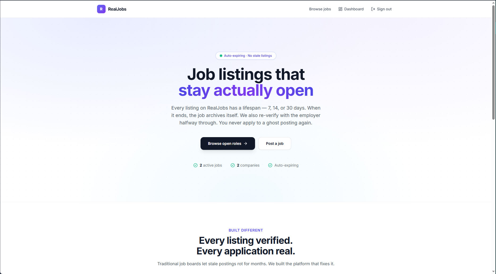
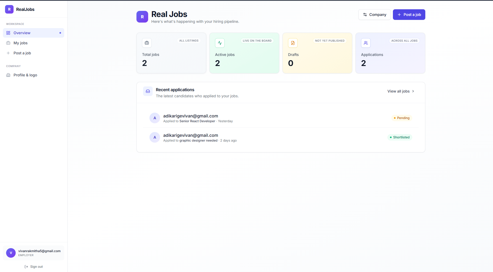
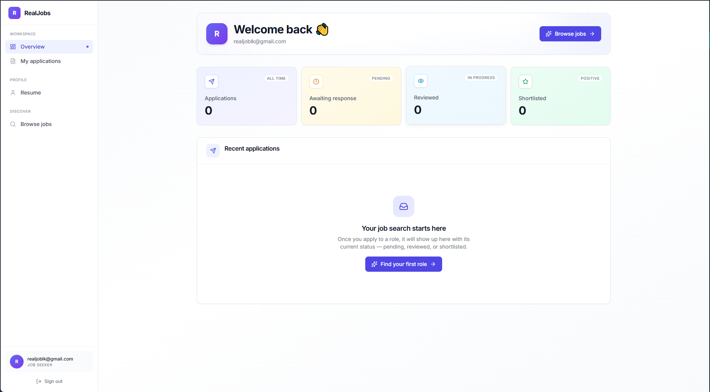
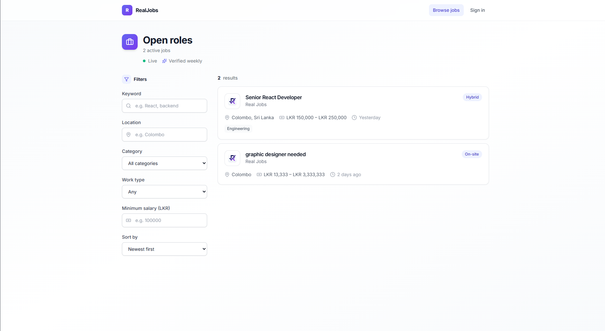
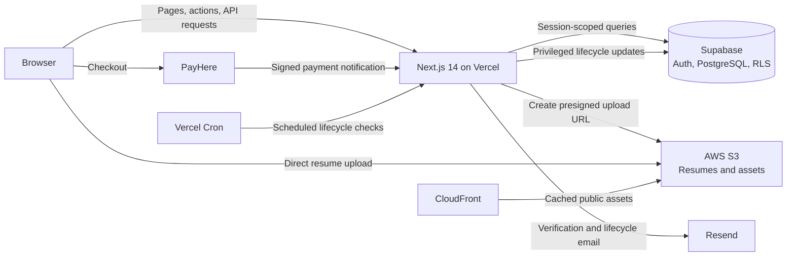

# RealJobs.lk

> **Sri Lanka's first automated job board. Zero ghost jobs.**

[](https://nextjs.org/)
[](https://www.typescriptlang.org/)
[](https://supabase.com/)
[](https://aws.amazon.com/)
[](https://vercel.com/)

RealJobs.lk is a two-sided hiring platform built around one principle: a job listing should remain public only while the employer is actively hiring. Its automated verification loop helps candidates spend their time on opportunities that are still open.

## Live Demo

**Production:** [https://www.realjobs.lk](https://www.realjobs.lk)

The local Supabase seed includes test accounts for exploring both dashboard roles:

| Role | Email | Password |
|---|---|---|
| Employer | `employer@example.com` | `password123` |
| Job seeker | `seeker@example.com` | `password123` |

These are **local development credentials only**. They are not credentials for the production site.

## Why RealJobs

### The problem: ghost jobs

Job seekers routinely encounter listings for roles that have already been filled, paused, or abandoned. A listing can remain online long after it stops representing a real opportunity. Candidates waste time applying, and employers receive applications for a role they no longer need to fill.

### The solution: an automated verification loop

Every 14 days, a scheduled job asks the employer to confirm that the role is still open. If the employer confirms, the listing stays active. If they say the role has been filled—or do not respond—the listing expires and is removed from the public job board. Verification emails and automatic expiration make freshness an operational rule rather than a promise.

## Screenshots

> Screenshot placeholders — add current product captures at the paths below.

### Landing page


### Employer dashboard


### Job seeker dashboard


### Job board


## Architecture



The browser communicates with the Next.js application for authenticated actions, but uploads resume files directly to S3 using short-lived presigned URLs. PayHere sends payment notifications to a server-side route, and Vercel Cron triggers scheduled job-verification and expiration work.

## Tech Stack

| Tech | Category | Rationale |
|---|---|---|
| Next.js 14 App Router | Frontend and API | Server Components, route handlers, and ISR in one application. |
| TypeScript | Language | Makes application, API, and database-facing code easier to reason about and change safely. |
| Tailwind CSS | Styling | Supports a consistent responsive interface without a large component-style layer. |
| Lucide React | Icons | Consistent, tree-shakeable icons across both dashboards and public pages. |
| Supabase PostgreSQL | Database | Relational data model with transactional updates, indexes, and Row-Level Security. |
| Supabase Auth | Authentication | Integrated identity and session management for employer and seeker workflows. |
| AWS S3 | Object storage | Stores resumes and company assets without routing file bytes through serverless functions. |
| Amazon CloudFront | Content delivery | Serves public assets through a CDN close to users. |
| PayHere | Payments | Sri Lankan payment gateway with a server-controlled checkout and verified notifications. |
| Resend | Email | Delivers job-verification requests and other automated lifecycle messages. |
| Vercel | Hosting and scheduling | Hosts the Next.js application and runs scheduled serverless cron routes. |

## Engineering & Design Decisions

### Three Supabase clients, three trust boundaries

The application uses separate Supabase clients for browser, server, and administrative work. The browser client uses the public anon key and is constrained by RLS. The server client carries the authenticated user's cookie-backed session, so normal server-side reads and writes continue to execute as that user. A separate admin client uses the service-role key for trusted operations such as payment notifications and cron processing; it is server-only and must never be exposed to browser code. Separating these clients makes privilege boundaries explicit and reduces the chance of accidentally using elevated access in a user-facing path.

### Direct-to-S3 uploads

Resume files do not pass through a Next.js route handler. The application authenticates the user, validates upload metadata, and creates a short-lived presigned URL. The browser then uploads directly to S3, while the database stores a reference to the resulting object. This zero-byte relay avoids consuming serverless memory and bandwidth on large file bodies and keeps the upload path scalable.

### PayHere: server-side checkout hashes and verified notifications

Checkout parameters and their MD5 hash are generated on the server from the merchant configuration, order details, amount, and currency. The merchant secret never goes to the browser. When PayHere posts a payment notification, the server recomputes the expected signature and compares it with the supplied `md5sig` before changing payment or job state. This prevents a client-side success redirect from being treated as proof of payment; the verified server-to-server notification is the authority for fulfillment.

### ISR and job-search SEO

Public job pages use Incremental Static Regeneration to serve cached content quickly while periodically refreshing it from the database. Public rendering uses an anonymous, cookie-free data path so that user session cookies do not force pages into dynamic rendering. Job detail pages expose structured JSON-LD data for Google Jobs discovery, alongside standard page metadata, canonical URLs, and crawlable job content.

### RLS as a data-access boundary

Row-Level Security policies enforce ownership in PostgreSQL, not only in the UI. Employers can access applications associated with their own jobs, and job seekers can access their own profile and application data. Public access is limited to eligible job listings. This provides a second enforcement layer if a route or client-side check is bypassed.

## Getting Started

### Prerequisites

- Node.js 18.18+ or 20.x
- npm
- A Supabase project and Supabase CLI
- AWS credentials and S3 buckets for upload features
- PayHere sandbox credentials for payment testing
- A Resend API key for email delivery

### Local setup

1. Clone the repository and install dependencies:

   ```bash
   git clone https://github.com/Vivan2025wd/real_jobs.git
   cd real_jobs
   npm install
   ```

2. Copy the environment template:

   ```powershell
   Copy-Item .env.local.example .env.local
   ```

3. Fill in the required values in `.env.local` (see [Environment variables](#environment-variables)).

4. Link the Supabase CLI to your development project and apply migrations:

   ```bash
   npx supabase link --project-ref <your-project-ref>
   npm run db:push
   ```

   `db:push` applies the migrations and generates the database TypeScript types. To load the repository's seed data into a local Supabase instance, start the local stack and reset its database:

   ```bash
   npx supabase start
   npx supabase db reset
   ```

5. Start the development server:

   ```bash
   npm run dev
   ```

   Open [http://localhost:3000](http://localhost:3000).

### Environment variables

Copy the values from your providers into `.env.local`. Do not commit this file or expose server-only secrets with a `NEXT_PUBLIC_` prefix.

| Variable | Purpose |
|---|---|
| `NEXT_PUBLIC_SUPABASE_URL` | Supabase project URL. |
| `NEXT_PUBLIC_SUPABASE_ANON_KEY` | Public Supabase key; database access remains subject to RLS. |
| `SUPABASE_SERVICE_ROLE_KEY` | Server-only key for trusted administrative operations. |
| `NEXT_PUBLIC_APP_URL` | Base URL used to construct application links. |
| `AWS_REGION` | AWS region containing the S3 buckets. |
| `S3_PRIVATE_BUCKET` | Private bucket for resumes. |
| `S3_PUBLIC_BUCKET` | Bucket for public company assets. |
| `CLOUDFRONT_PUBLIC_DOMAIN` | Optional CloudFront domain for public assets. |
| `AWS_ACCESS_KEY_ID` | AWS access key used by server-side S3 operations. |
| `AWS_SECRET_ACCESS_KEY` | AWS secret key; keep server-only. |
| `PAYHERE_MERCHANT_ID` | PayHere merchant ID. |
| `PAYHERE_MERCHANT_SECRET` | PayHere merchant secret; keep server-only. |
| `PAYHERE_MODE` | `sandbox` or `production`. |
| `RESEND_API_KEY` | Resend API key for transactional email. |
| `EMAIL_FROM` | Verified sender address for outgoing email. |
| `CRON_SECRET` | Secret used to authenticate scheduled cron requests. |

The repository's [.env.local.example](.env.local.example) documents the expected formats and includes safe placeholders.

## License

RealJobs.lk is licensed under the MIT License.
