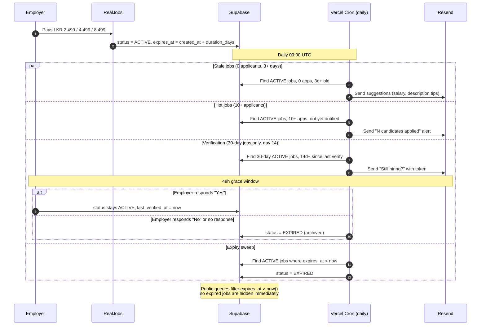

# RealJobs

> **The zero-stale job marketplace.** Every listing runs for a fixed window (7, 14, or 30 days) and archives itself when the window ends. No ghost posts, no dead applications.

[](https://nextjs.org/)
[](https://www.typescriptlang.org/)
[](https://supabase.com/)
[](https://aws.amazon.com/s3/)
[](https://vercel.com/)

[Live Demo](https://realjobs-khaki.vercel.app) · [Report a Bug](https://github.com/Vivan2025wd/real_jobs/issues) · [Request a Feature](https://github.com/Vivan2025wd/real_jobs/issues)

---

## Why RealJobs

Traditional job boards suffer from one systemic flaw: **stale, ghost listings**. Employers fill a role and forget to remove the post, leaving job seekers shouting into the void and recruiters buried in irrelevant applications.

RealJobs fixes this at the data layer:

1. Every listing has an **`expires_at` timestamp** set at creation, from the duration the employer paid for (7, 14, or 30 days).
2. **Public queries filter on `expires_at > now()`**, so expired listings disappear from search the moment their window ends.
3. A **daily cron** archives expired jobs and sends lifecycle notifications (applicant milestones, no-applicant tips, and a mid-life verification for 30-day listings).

The result: every public listing is within the lifespan its employer chose and paid for.

---

## Table of Contents

- [Live Demo](#live-demo)
- [Core Features](#core-features)
- [The Listing Lifecycle](#the-listing-lifecycle)
- [Pricing](#pricing)
- [Tech Stack](#tech-stack)
- [Architecture](#architecture)
- [Database Schema & RLS](#database-schema--rls)
- [Getting Started](#getting-started)
  - [Prerequisites](#prerequisites)
  - [Local Development](#local-development)
  - [Environment Variables](#environment-variables)
  - [AWS S3 Setup](#aws-s3-setup)
- [Deployment](#deployment)
- [Project Structure](#project-structure)
- [Design Decisions](#design-decisions)
- [Engineering Audit & Resolution](#engineering-audit--resolution)
- [Roadmap](#roadmap)
- [License](#license)

---

## Live Demo

**[realjobs-khaki.vercel.app](https://realjobs-khaki.vercel.app)**

Key screens to try:

- **`/`**: landing page with live stats (active jobs, companies)
- **`/jobs`**: public board with category, work type, and salary filters
- **`/jobs/[id]`**: job detail with Google Jobs JSON-LD schema
- **`/dashboard/employer`**: employer dashboard
- **`/dashboard/employer/jobs/new`**: duration-based pricing picker (7 / 14 / 30 days)

---

## Core Features

### For Employers
- **Company Profile Management**: company identity, logo, and verified badge.
- **Structured Job Authoring**: role descriptions, compensation ranges in LKR, work type (Remote, Hybrid, Onsite), and standardized categories.
- **Tiered Pricing & Payments**: choose 7, 14 or 30 days (LKR 2,499 / 4,499 / 8,499) and pay via PayHere popup checkout.
- **Applicant Tracking**: review applications per listing with applied dates, statuses, and resume downloads.
- **Smart Notification Emails**: a "candidates are applying" alert at 10+ applicants, improvement tips when a listing has no applicants after 3 days, and a one-click "still hiring?" check on 30-day listings.

### For Job Seekers
- **Fresh Postings**: only listings inside their paid lifespan appear publicly, and filled roles can be closed in one click.
- **One-Click Application**: upload a resume once and apply to any open position without re-uploading.
- **Privacy & Performance**: resumes upload directly from the browser to a private AWS S3 bucket.
- **Application Dashboard**: track status (Pending, Reviewed, Shortlisted, Rejected).

### Platform & Automation
- **Four automated tasks**: stale-listing tips, hot-listing alerts, mid-life verification and an expiry sweep, combined into one daily cron.
- **Transactional email**: Resend integration.
- **Incremental Static Regeneration (ISR)**: public job detail pages are cached and revalidated every 5 minutes.
- **Role-Based Routing**: middleware-enforced isolation between seeker and employer areas.

---

## The Listing Lifecycle

RealJobs runs four automated tasks. They are combined into a single daily Vercel Cron (`/api/cron/daily`, 09:00 UTC) to fit Vercel Hobby plan limits.



> **Notes**
> - Each notification is sent once per job; the `notified_*_at` columns prevent duplicates.
> - The mid-life verification only applies to 30-day listings, since 7 and 14-day listings expire before the check is due.
> - A listing marked "position filled" through the verification link is closed as `FILLED`.

---

## Pricing

| Duration | Price (LKR) |
| :--- | :--- |
| 7 days | 2,499 |
| 14 days | 4,499 |
| 30 days | 8,499 |

The price is locked when the draft is created and paid through PayHere. The listing goes live when the payment webhook is verified.

---

## Tech Stack

| Layer | Technology | Rationale |
| :--- | :--- | :--- |
| **Framework** | Next.js 14 (App Router) | Server Components for fast initial paint, Server Actions for mutations, and Edge Middleware for auth routing. |
| **Language** | TypeScript 5.6 (Strict) | End-to-end type safety across database schemas, API contracts, and form inputs. |
| **Database** | Supabase (PostgreSQL 15) | Relational integrity, cascading foreign keys, and Row-Level Security (RLS). |
| **Auth** | Supabase Auth | Cookie-based sessions with PKCE exchange, magic link OTP, and role metadata. |
| **Object Storage** | AWS S3 | Private bucket for resumes; public bucket for company logos. |
| **Payments** | PayHere | Sri Lankan payment gateway with server-hashed checkout and `md5sig` webhook verification. |
| **Messaging** | Resend (email), WhatsApp Cloud API (planned) | Transactional email now; WhatsApp as a second channel for owners who rarely check email. |
| **Styling** | Tailwind CSS | Utility-first CSS with minimal production bundles. |
| **Hosting & Crons** | Vercel | Edge network with integrated Vercel Cron for scheduled tasks. |

---

## Architecture

```text
                 ┌────────────────────────────────────────┐
                 │             Client Browser             │
                 └───────┬────────────────────────▲───────┘
                         │ HTTPS                  │ Direct PUT
                         ▼                        │ (presigned URL)
                 ┌───────────────────────┐        │
                 │  Next.js 14 on Vercel │        │
                 │  (App Router / ISR)   │        │
                 └───┬───────────────┬───┘        │
        Cookies / RLS│               │Service role│
                     ▼               ▼ (cron/webhook)
          ┌──────────────────┐  ┌──────────────┐  │
          │ Supabase Auth &  │  │  Admin DB    │  │
          │ PostgreSQL       │  │  access      │  │
          └──────────────────┘  └──────┬───────┘  │
                                       │          │
   ┌──────────────────────┐            ▼          ▼
   │ PayHere Gateway      │──────▶ (webhook)   ┌────────────────┐
   └──────────────────────┘                    │ AWS S3 Buckets │
                                               │ resumes / logos│
          ┌──────────────────┐                 └────────────────┘
          │  Resend (email)  │──▶ Employer inbox
          └──────────────────┘
```

### Key Architectural Tenets

1. **Three-Client Supabase Pattern**
   - `client.ts`: browser-only client using `createBrowserClient` with the public anon key and RLS.
   - `server.ts`: Server Component / Server Action client using cookie storage with RLS.
   - `admin.ts`: service-role client guarded with `server-only`, reserved for webhooks and cron tasks.
2. **Zero-Byte File Relay**: resumes never pass through the Next.js server. The client requests a 5-minute presigned PUT URL and uploads directly to S3.
3. **Cookie-Free ISR for Public Pages**: `/jobs/[jobId]` statically pre-renders with `revalidate = 300` using a cookie-free anonymous Supabase client.

---

## Database Schema & RLS

RealJobs uses five relational tables in PostgreSQL:

- `public.users`: mirrors `auth.users` with `role` (`EMPLOYER` or `JOB_SEEKER`) and `resume_url`.
- `public.companies`: employer company profiles (`employer_id` references `users.id`).
- `public.jobs`: listings with work type, salary range, status, and the lifecycle fields below:
  - `duration_days`: 7, 14 or 30
  - `price_lkr`: price locked at creation (2,499 / 4,499 / 8,499)
  - `expires_at`: `created_at + duration_days`
  - `last_verified_at` and the verification token
  - `notified_10_applicants_at`, `notified_stale_at`, `notified_expiring_at`: guards that stop duplicate notification emails
- `public.applications`: links `job_id` and `seeker_id`, with a unique constraint preventing duplicate submissions.
- `public.payments`: payment audit ledger tracking PayHere `order_id`, amount, and gateway references.

### Row-Level Security Highlights

- **Companies**: readable by everyone; writes restricted to the owner (`auth.uid() = employer_id`).
- **Jobs**: active jobs are public; drafts and archived jobs are visible only to the owning company.
- **Applications**: seekers can insert and read only their own applications; employers can read only applications for jobs their company owns.
- **Payments**: users can read only their own payments. Webhooks use the service role.

---

## Getting Started

### Prerequisites

- Node.js 18.18+ or 20.x
- AWS account with S3 buckets and IAM user credentials
- Supabase project (cloud or local Supabase CLI)
- PayHere merchant account (or sandbox credentials)
- Resend account and a verified sending domain

### Local Development

1. **Clone the repository**
   ```bash
   git clone https://github.com/Vivan2025wd/real_jobs.git
   cd real_jobs
   ```

2. **Install dependencies**
   ```bash
   npm install
   ```

3. **Configure environment variables**
   ```bash
   cp .env.local.example .env.local
   # Fill in your Supabase, AWS, PayHere, and Resend credentials
   ```

4. **Initialize Supabase**
   ```bash
   # Link to your Supabase project
   npx supabase link --project-ref <your-project-ref>

   # Push schema migrations
   npx supabase db push

   # Generate TypeScript types from the live schema
   npx supabase gen types typescript --project-id <your-project-ref> > src/types/database.types.ts
   ```
   > On Windows PowerShell, use `| Out-File src/types/database.types.ts -Encoding utf8` instead of `>`.

5. **Run the development server**
   ```bash
   npm run dev
   ```
   Open [http://localhost:3000](http://localhost:3000).

### Environment Variables

```bash
# ==============================================================================
# Supabase
# ==============================================================================
NEXT_PUBLIC_SUPABASE_URL=https://your-project.supabase.co
NEXT_PUBLIC_SUPABASE_ANON_KEY=eyJhbGciOiJIUzI1NiIsInR5cCI6...
# Service role key must NEVER be prefixed with NEXT_PUBLIC_
SUPABASE_SERVICE_ROLE_KEY=eyJhbGciOiJIUzI1NiIsInR5cCI6...

# ==============================================================================
# Application URL
# ==============================================================================
# Local: http://localhost:3000
# Production: https://your-app.vercel.app  (must include https://)
NEXT_PUBLIC_APP_URL=http://localhost:3000

# ==============================================================================
# AWS S3 (private resumes & public logos)
# ==============================================================================
# AWS_REGION must exactly match the region your buckets live in.
# Common values: ap-southeast-2 (Sydney), ap-south-1 (Mumbai), us-east-1 (N. Virginia)
AWS_REGION=ap-southeast-2

# Use the FULL bucket names from the AWS Console (including any suffix).
S3_PRIVATE_BUCKET=your-resumes-bucket-name
S3_PUBLIC_BUCKET=your-assets-bucket-name

# Optional. Leave EMPTY to serve logos directly from S3.
# Only set if you have a CloudFront distribution, e.g. https://d111111abcdef8.cloudfront.net
# Placeholder values such as "https://cdn.yourdomain.com" are detected and ignored.
CLOUDFRONT_PUBLIC_DOMAIN=

AWS_ACCESS_KEY_ID=AKIA...
AWS_SECRET_ACCESS_KEY=...

# ==============================================================================
# PayHere (Sri Lanka)
# ==============================================================================
PAYHERE_MERCHANT_ID=1210000
PAYHERE_MERCHANT_SECRET=your_payhere_merchant_secret
# 'sandbox' for staging, 'production' for live payments
PAYHERE_MODE=sandbox

# ==============================================================================
# Resend
# ==============================================================================
RESEND_API_KEY=re_...
# For testing, "onboarding@resend.dev" only delivers to your own verified email.
# For production, verify a domain and use e.g. "notifications@yourdomain.com".
EMAIL_FROM=RealJobs <onboarding@resend.dev>

# ==============================================================================
# WhatsApp Business Cloud API (optional, planned)
# ==============================================================================
# NOT USED YET: no code reads these variables, so setting them currently does nothing.
# Business-initiated messages will need an approved message template.
WHATSAPP_TOKEN=
WHATSAPP_PHONE_NUMBER_ID=
WHATSAPP_TEMPLATE_NAME=listing_expiring

# ==============================================================================
# Cron security
# ==============================================================================
# Generate with: openssl rand -base64 32
# Or PowerShell: [Convert]::ToBase64String((1..32 | ForEach-Object { Get-Random -Max 256 }))
# Must also be set in Vercel env vars, otherwise crons return 401.
CRON_SECRET=
```

### AWS S3 Setup

#### Resumes bucket (private)

Create a bucket with **Block Public Access enabled** (the default), then add this CORS configuration so browsers can upload with `PUT`:

```json
[
  {
    "AllowedHeaders": ["*"],
    "AllowedMethods": ["PUT", "GET", "HEAD"],
    "AllowedOrigins": [
      "http://localhost:3000",
      "https://your-app.vercel.app"
    ],
    "ExposeHeaders": ["ETag"],
    "MaxAgeSeconds": 3000
  }
]
```

#### Logos bucket (public)

Create a **second** bucket for company logos with:

1. **Block Public Access disabled** (uncheck all four boxes).
2. A **bucket policy** allowing public reads:

   ```json
   {
     "Version": "2012-10-17",
     "Statement": [
       {
         "Sid": "PublicReadLogos",
         "Effect": "Allow",
         "Principal": "*",
         "Action": "s3:GetObject",
         "Resource": "arn:aws:s3:::your-assets-bucket-name/*"
       }
     ]
   }
   ```

3. The **same CORS configuration** as above.

#### IAM permissions

The IAM user needs object access on both buckets, plus `ListBucket`:

```json
{
  "Version": "2012-10-17",
  "Statement": [
    {
      "Effect": "Allow",
      "Action": ["s3:PutObject", "s3:GetObject", "s3:DeleteObject"],
      "Resource": [
        "arn:aws:s3:::your-resumes-bucket-name/*",
        "arn:aws:s3:::your-assets-bucket-name/*"
      ]
    },
    {
      "Effect": "Allow",
      "Action": ["s3:ListBucket"],
      "Resource": [
        "arn:aws:s3:::your-resumes-bucket-name",
        "arn:aws:s3:::your-assets-bucket-name"
      ]
    }
  ]
}
```

---

## Deployment

### Vercel

1. Connect your repository to Vercel.
2. Under Project Settings → Environment Variables, add every variable from `.env.local.example`.
3. Vercel reads `vercel.json` and configures one daily cron, `/api/cron/daily` (09:00 UTC), which runs four tasks:
   - `verify-jobs`: sends the "still hiring?" email 14 days after `last_verified_at` (30-day listings)
   - `notify-hot-jobs`: emails the employer when a listing reaches 10+ applicants
   - `notify-stale-jobs`: emails tips when a listing has 0 applicants after 3 days
   - `expire-jobs`: archives listings once `expires_at` has passed

### Post-Deploy Checklist

- [ ] `CRON_SECRET` is set in Vercel and matches what the cron routes expect (Vercel sends it as a `Bearer` token in the `Authorization` header).
- [ ] PayHere merchant portal has the return URL, cancel URL, and notify URL domain whitelisted.
- [ ] Your domain is verified in Resend so notification emails pass SPF/DKIM.
- [ ] S3 CORS allows your production Vercel domain on **both** buckets.
- [ ] The assets bucket is publicly readable (open a logo URL in a private browser window).
- [ ] `/api/cron/daily` runs successfully from Vercel dashboard → Cron Jobs → Run, returning `{ ok: true }`.

---

## Project Structure

```text
├── public/                  # Static assets (logos, favicon)
├── scripts/
│   └── generate-db-types.ts # Supabase TypeScript schema generator
├── src/
│   ├── app/
│   │   ├── (auth)/          # Login, register, auth callback
│   │   ├── api/             # Route handlers (cron, payments, S3 presigned)
│   │   ├── dashboard/       # Protected employer and seeker dashboards
│   │   ├── jobs/            # Public job browse, search, and detail (ISR)
│   │   ├── verify-job/      # Tokenized single-click verification page
│   │   ├── layout.tsx       # Root layout
│   │   └── page.tsx         # Landing page
│   ├── components/
│   │   ├── applications/    # Application cards and apply button
│   │   ├── auth/            # Split-screen AuthShell
│   │   ├── employer/        # Job form, verification toggle, logo uploader
│   │   ├── jobs/            # Job cards, search filters, detail view
│   │   ├── payment/         # PayHere checkout button wrapper
│   │   ├── seeker/          # Resume uploader
│   │   └── ui/              # Design system primitives (Button, Card, Badge)
│   ├── hooks/               # Custom hooks (useJobs, useUser)
│   ├── lib/
│   │   ├── cron/            # Job lifecycle automation
│   │   ├── email/           # Resend client
│   │   ├── payhere/         # Hash generation & md5sig verification
│   │   ├── s3/              # S3 client and presigned URL builder
│   │   ├── supabase/        # client.ts, server.ts, admin.ts
│   │   ├── utils/           # Formatting, constants
│   │   └── validators/      # Zod schemas
│   ├── types/               # Domain and database types
│   └── middleware.ts        # Session refresh and role-based routing
├── supabase/
│   ├── migrations/          # PostgreSQL migrations
│   ├── config.toml          # Local Supabase CLI config
│   └── seed.sql             # Local test data
├── vercel.json              # Deployment config & cron schedule
├── package.json
└── tsconfig.json
```

---

## Design Decisions

### 1. Employer-Chosen Lifespans Instead of Open-Ended Listings
Most job boards leave posts up until someone remembers to remove them, which creates zombie listings long after a role is filled. Small businesses usually hire fast, so RealJobs sells short, fixed windows (7, 14 or 30 days) with the price locked at creation. Automated emails keep employers engaged while the listing runs: a signal when candidates are flowing in, tips when nobody is applying, and a still-hiring check on 30-day listings. A filled role can be closed in one click, and everything else expires on its own.

### 2. Three-Client Supabase Architecture
Supabase auth in the Next.js App Router needs strict client boundaries:
- `client.ts` uses `@supabase/ssr`'s `createBrowserClient` with the anon key for interactive components.
- `server.ts` uses `createServerClient` with `next/headers` cookies, propagating refreshed tokens while respecting RLS.
- `admin.ts` uses `@supabase/supabase-js` with the service-role key and `import "server-only"` so it can never be bundled into client code. It is used only by webhooks and cron routes.

### 3. Direct Browser-to-S3 Presigned Uploads
Streaming resumes through serverless functions consumes compute, can hit Vercel's 4.5 MB payload limit, and exposes the server to uninspected byte streams. Instead, the server validates the MIME type and size, authenticates the user, and signs an S3 `PutObjectCommand`. The browser uploads directly to AWS, and only the sanitized object key is stored in PostgreSQL.

### 4. ISR with Cookie-Free Anonymous Clients
Accessing `cookies()` during rendering silently turns a static page into a dynamic one. In `/jobs/[jobId]/page.tsx`, a standalone cookie-free anonymous Supabase client plus `revalidate = 300` keeps the page statically cacheable, crawlable, and able to emit Google Jobs JSON-LD.

### 5. Server-Generated Payment Hashing & Webhook Verification
Client-side payment parameters can be tampered with. The checkout hash (`MD5(merchant_id + order_id + amount + currency + uppercase(MD5(secret)))`) is computed only on the server in `/api/payment/start`. The `/api/payment/notify` webhook verifies the incoming `md5sig` with `timingSafeEqual` before updating payment state or activating draft jobs.

### 6. Defense-in-Depth Route Protection
1. `src/middleware.ts` checks sessions at the edge, refreshes expired tokens, and enforces role boundaries (`/dashboard/employer` vs `/dashboard/seeker`).
2. `src/app/dashboard/layout.tsx` independently calls `supabase.auth.getUser()` on the server so direct requests can't bypass middleware.
3. PostgreSQL RLS policies restrict all data access to `auth.uid()`.

---

## Engineering Audit & Resolution

Before the initial deploy, the project went through a structured engineering audit. 18 issues were identified across four severity bands and resolved, with `tsc --noEmit` and `next build` passing.

| Wave | Severity | Issues | Status |
| :--- | :--- | :---: | :--- |
| 1 | 🔴 Critical | 3 | ✅ Resolved |
| 2 | 🟠 High | 6 | ✅ Resolved |
| 3 | 🟡 Medium | 6 | ✅ Resolved |
| 4 | 🟢 Low | 3 | ✅ Resolved |

### Highlights

**Critical**
- Fixed the PostgREST two-level join in the verification cron (`jobs → companies → users`), which collapsed to `never` and broke the send loop.
- Removed redundant client-side upserts now handled by the `handle_new_user()` trigger (they failed under RLS because `users` has no client INSERT policy).
- Populated `.env.local.example` to prevent silent misconfiguration.

**High**
- Added `timingSafeEqual` cron secret verification with header-only auth (removed the query-string secret).
- Fixed sign-out: `/logout` is a POST-only route and the Navbar and Sidebar use `<form action="/logout" method="post">`. (A GET handler was tried first, but link prefetching triggered it on page load and signed users out, so it was reverted.)
- Preserved `category` through job create/edit Server Actions.
- Fixed the employer dashboard applications counter (`job_id!inner` → `jobs!inner`).
- Restored ISR caching on category pages via cookie-free clients.
- Implemented employer resume downloads via presigned `GetObjectCommand` URLs.

**Medium**
- Reordered the PayHere webhook to activate the job before marking the payment `COMPLETED`, preventing stuck `DRAFT` jobs on retry.
- Consolidated duplicate type definitions and constants across `types/` and `lib/`.
- Removed leftover `console.log` calls from the payment flow.
- Added RLS-supporting indexes on `applications.seeker_id`, `companies.employer_id`, `jobs.company_id`, and `payments.user_id`.
- Updated stale UI copy ("payment coming soon" → "pay to publish").
- Adopted the `JobList` component in `/jobs` to remove dead code.

**Low**
- Added a company logo uploader wired to the presigned URL endpoint.
- Enforced a role check on resume uploads (employers cannot upload resumes).
- Corrected `searchParams` typing in auth pages (Next.js 14 convention).

### Current status

No known outstanding bugs at the time of writing. `tsc --noEmit` and `next build` pass, the cron jobs have been triggered manually from the Vercel dashboard, and the payment flow, resume upload, logo upload, sign-out, and verification loop have been exercised end to end.

---

## Roadmap

- [x] Remediate pre-launch audit items (18 issues)
- [x] Presigned S3 download links for employer resume viewing
- [x] Employer company logo upload via public S3 bucket
- [x] Correct sign-out flow across Navbar and Sidebar
- [x] "Still hiring?" verification email with one-click confirm/close links
- [ ] Applicant cover notes and portfolio links
- [x] 7/14/30-day tiered listings with auto-archive at expiry
- [x] Hot-listing email at 10+ applicants
- [x] Stale-listing tips email at 3+ days with 0 applicants
- [ ] One-click renew flow (extend `expires_at` via a PayHere payment)
- [ ] Expiry-warning email before a listing ends (`notified_expiring_at` is reserved for this)
- [ ] WhatsApp notifications as a second channel (not yet implemented)
- [ ] Free repost guarantee when a listing gets zero applicants
- [ ] Slack/Discord webhook for candidate application alerts
- [ ] Public REST API for job aggregators
- [ ] Native mobile app (React Native)

---

## License

This project is licensed under the MIT License. See [LICENSE](LICENSE) for details.

---

[Back to top ↑](#realjobs)